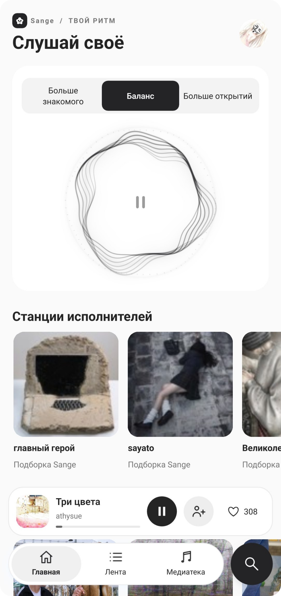

<p align="center">
  
</p>

<h1 align="center">SCrip</h1>

<p align="center">Your SoundCloud music, in a dedicated player for Windows, Linux and Android.<br>Discover personal mixes, explore artist stations and keep your favorites close.</p>

<p align="center">
  <a href="https://github.com/sykia/SCrip/releases/download/v1.6.1/SCrip-1.6.1-Windows-x64.exe"></a>
  <a href="https://github.com/sykia/SCrip/releases/download/v1.6.1/SCrip-1.6.1-debian13-amd64.deb"></a>
  <a href="https://github.com/sykia/SCrip/releases/download/v1.6.1/scrip-1.6.1-1-x86_64.pkg.tar.zst"></a>
  <a href="https://github.com/sykia/SCrip/releases/download/v1.6.0/SCrip-1.6.0-Android-universal.apk"></a>
</p>

<p align="center">
  <a href="CHANGELOG.md">Changelog</a> ·
  <a href="https://github.com/sykia/SCrip/releases/tag/v1.6.1">Release files &amp; SHA-256</a> ·
  <a href="docs/plugins.md">Plugins</a>
</p>

## Get started

Install the package for your platform and sign in through the official SoundCloud page in your browser. SCrip uses the official SoundCloud API.

Desktop packages are at **1.6.1**; Android is at **1.6.0**. The universal APK supports ARM64, ARMv7 and x86-64. Install it over your existing release to keep your local data.

## Find your next favorite

Start a personal mix from Home, browse its track list and save a discovery to your likes or a playlist. Open an artist station to explore related music, or catch up with new releases.


## Make the queue your own

Browse your favorites by artwork and open an artist's profile from their name. Drag tracks into order or choose **Play next**. On desktop, minimize SCrip to the system tray to control playback and like tracks from the icon menu.


## Share what you are listening to

Desktop settings include optional [Discord Rich Presence](docs/discord-presence.md): clickable track title, artist, cover, elapsed / total track progress, a SCrip badge, and buttons to open the track or download SCrip on GitHub. It requires the Discord desktop client; the shared project Application ID is already configured.

## Take your music with you

Android includes a dedicated touch interface, a full-screen player, background playback and system media controls.

<p align="center">
  
  
</p>

## Build from source

SCrip uses **C++20, Qt Quick and CMake**. For a desktop build, install CMake 3.21+, Ninja, a C++20 compiler and Qt 6.5+ with Quick, Network, Multimedia, Widgets, Test and QuickTest. Linux also requires pkg-config and libsecret development files (`libsecret-1-dev` on Debian/Ubuntu or `libsecret` on Arch), plus a running, unlocked Secret Service for sign-in.

```sh
cmake --preset debug
cmake --build --preset debug
ctest --test-dir build/debug --output-on-failure
```

Run `build/debug/scrip` on Linux or `build/debug/scrip.exe` on Windows. Build output stays in `build/`. The desktop interface is in `qml/Main.qml`, the Android interface in `qml/android/Main.qml`, and the entry point in `src/main.cpp`.

`tests/` contains regression checks, `worker/` contains the SoundCloud authentication service, and `.github/workflows/` contains automated checks and Windows build workflows. Packaging files are in `packaging/`; reusable example plugins are in `examples/plugins/`. Editor settings and local caches are excluded from Git.

See [SoundCloud integration and secure storage](docs/soundcloud-security.md), the [plugin guide](docs/plugins.md), the [Plugin API reference](docs/plugin-api-v2-reference.md), the [trusted QML plugin SDK](docs/plugin-runtime.md) and [Android playback diagnostics](docs/android-playback-diagnostics.md) for technical details. For installer issues, see [Windows troubleshooting](docs/windows-install.md).

## License

SCrip is independent software and is not an official SoundCloud product.

Copyright (c) 2026 sykia. The source code is licensed under **GNU GPL v3.0 only (GPL-3.0-only)**. You may use, study, modify and redistribute it under the terms of [LICENSE](LICENSE).

Third-party components retain their own licenses; see [Third-party notices](THIRD_PARTY_NOTICES.md). The [name and original logo](TRADEMARKS.md) may be copied and modified under the GPL without additional restrictions. [Release licensing materials](licensing/README.md) document the distribution process.

### Personal wave (beta)

The home screen includes a continuous wave above the mixes on desktop and Android.
“My music” shuffles paginated SoundCloud likes, cycling after the library ends.
“Discoveries” uses liked tracks as seeds for SoundCloud related-track requests,
rotates seeds, excludes session duplicates and expands the seed pool with discoveries.
This is a heuristic using SoundCloud recommendations, not an audio analysis model.
The queue refills near its end; switching to a track, mix or station cancels the wave.
Failures preserve the queue and expose a retry action. Empty recommendation batches
are bounded to avoid a request loop. Playback history is bounded during refills.
The visual is a single-pass GPU fragment shader compiled with Qt Shader Tools
(GLSL/SPIR-V/HLSL packages for Linux, Android and Windows). Six smoothly merging
circular fields use shades of the current accent. The shader renders at a maximum
width of 720 pixels and updates at ~30 fps, without CPU canvas drawing or blur passes.
The title sits above the visual and the mode selector below it. Clicking the visual
starts, pauses or resumes the wave; keyboard Space/Return and accessibility press
actions are supported. Animation continues when the window loses focus or moves to
another monitor. It stops outside the viewport, in a hidden/minimized window, or
when motion is disabled. The software renderer uses a static fallback.
On Qt 6.8+ with the FFmpeg backend, QAudioBufferOutput supplies decoded PCM: a
lightweight RMS envelope and a 160 Hz low-pass envelope drive expansion and light.
Bass onsets use an adaptive baseline with a 180 ms refractory interval; this is an
onset heuristic, not BPM tracking. Analysis is downsampled to <=12 kHz, emits
separate visual signals at ~30 Hz and detaches when the wave visual is inactive.
Other backends and older Qt retain ambient motion without fabricated beat data. Wave sessions are not restored after restarting the app.
