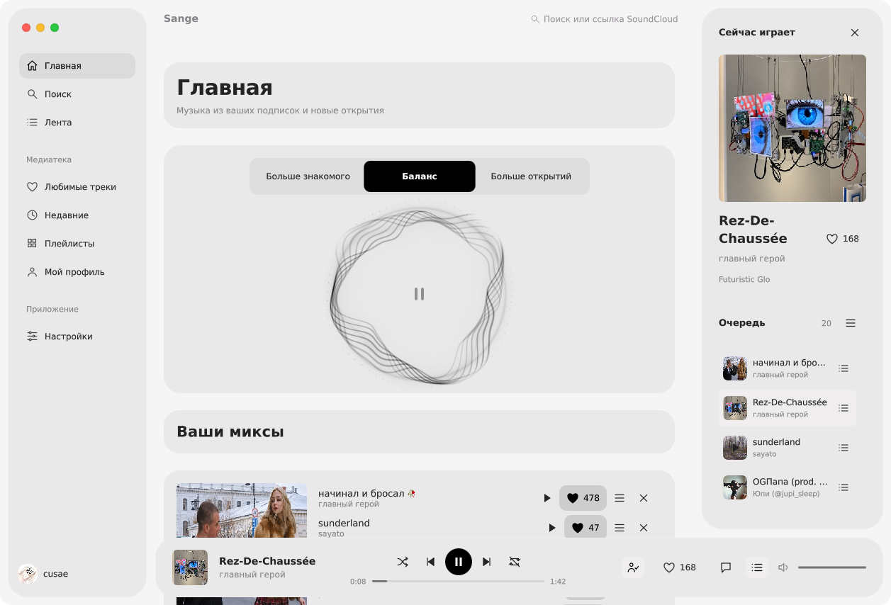
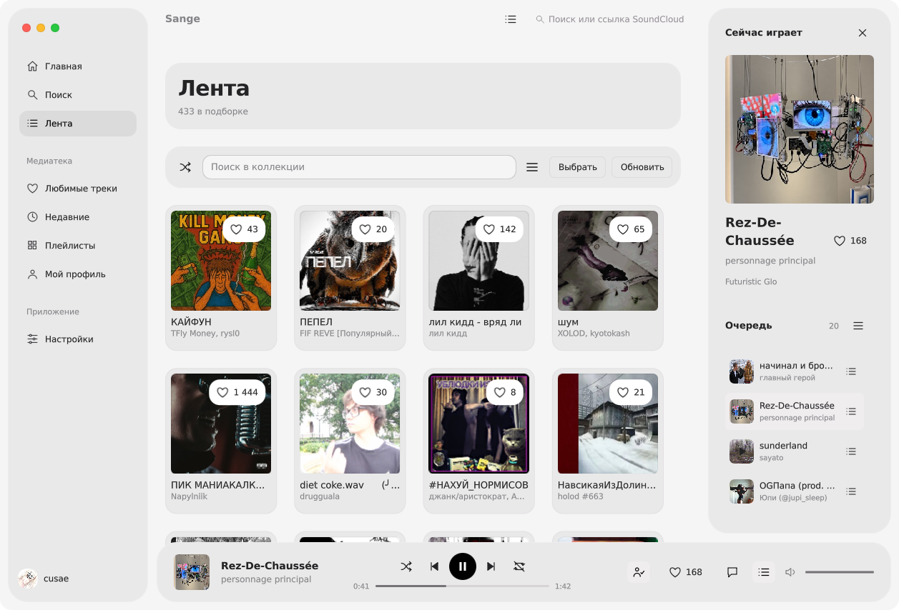

<p align="center">
  
</p>

<h1 align="center">Sange</h1>

<p align="center">Your SoundCloud music, in a dedicated player for macOS, Windows, Linux and Android.<br>Discover personal mixes, explore artist stations and keep your favorites close.</p>

<p align="center">
  <a href="https://github.com/sykia/sange/releases/download/v2.1.0/Sange-2.1.0-macOS-arm64.dmg"></a>
  <a href="https://github.com/sykia/sange/releases/download/v2.1.0/Sange-2.1.0-macOS-x86_64.dmg"></a>
  <a href="https://github.com/sykia/sange/releases/download/v2.1.0/Sange-2.1.0-Windows-x64.exe"></a>
  <a href="https://github.com/sykia/sange/releases/download/v2.1.0/Sange-2.1.0-debian13-amd64.deb"></a>
  <a href="https://github.com/sykia/sange/releases/download/v2.1.0/scrip-2.1.0-1-x86_64.pkg.tar.zst"></a>
  <a href="https://github.com/sykia/sange/releases/download/v2.1.0/Sange-2.1.0-Android-universal.apk"></a>
</p>

<p align="center">
  <a href="CHANGELOG.md">Changelog</a> ·
  <a href="https://github.com/sykia/sange/releases/latest">Release files &amp; SHA-256</a> ·
  <a href="docs/plugins.md">Plugins</a> ·
  <a href="https://github.com/sykia/sange/wiki">Wiki</a>
</p>

<p align="center">
  <a href="https://github.com/sykia/sange/releases/latest"></a>
  <a href="https://github.com/sykia/sange/actions/workflows/linux-cpp.yml"></a>
  <a href="https://github.com/sykia/sange/actions/workflows/licenses.yml"></a>
  <a href="LICENSE"></a>
</p>

## Get started

Install the package for your platform and sign in through the official SoundCloud page in your browser. Sange uses the official SoundCloud API.

**2.1.0** adds persistent English/Russian interface selection, playback recovery, media-session improvements and fixes for search, lyrics, recommendations and streaming. Packages are available for Windows, Debian 13, Arch Linux, Android and macOS. See the [release notes](release-notes/2.1.0.md). macOS requires 14.4+; disk images are not Apple-notarized.

Upgrading from SCrip? Install over your existing application to keep your settings and music data. See the [upgrade notes](release-notes/2.0.0.md) if an older build cannot download updates.

## Your music, your rhythm

- **Discover:** start a continuous personal wave, adjust the balance between familiar music and discoveries, explore mixes and artist stations.
- **Explore:** search tracks, playlists and people; browse your feed, likes, recent tracks and profiles.
- **Organize:** edit playlists, reorder the queue, choose **Play next**, remove duplicates or save the queue as a playlist.
- **Keep listening:** use system media controls, desktop shortcuts and Android background playback.
- **Make it yours:** customize the appearance, add [plugins](docs/plugins.md) and enable optional [Discord Rich Presence](docs/discord-presence.md) on desktop.

## On desktop

Home brings the personal wave and mixes together. The feed keeps music from your subscriptions within reach, with the player and queue alongside it.





## On Android

A dedicated touch interface with discovery, search, a full-screen player, background playback and system media controls.

<p align="center">
  
  
</p>

## Build from source

Sange uses **C++20, Qt Quick and CMake**. For a desktop build, install CMake 3.21+, Ninja, a C++20 compiler and Qt 6.5+ with Quick, Network, Multimedia, ShaderTools and Widgets, plus Test and QuickTest for the default test-enabled build. Linux also requires Qt DBus, pkg-config and libsecret development files (`libsecret-1-dev` on Debian/Ubuntu or `libsecret` on Arch), plus a running, unlocked Secret Service for sign-in.

```sh
cmake --preset debug
cmake --build --preset debug
ctest --test-dir build/debug --output-on-failure
```

Run `build/debug/scrip` on Linux or `build/debug/scrip.exe` on Windows. For platform-specific setup, see [macOS](https://github.com/sykia/sange/blob/v2.0.1/docs/macos.md) or the [Android build script](scripts/build_android.sh). macOS release builds use Qt 6.12.0.

## Documentation

[Wiki](https://github.com/sykia/sange/wiki) · [Plugins](docs/plugins.md) · [Playback](docs/system-media-and-streaming.md) · [Diagnostics](https://github.com/sykia/sange/blob/v2.0.1/docs/diagnostics.md) · [Windows troubleshooting](docs/windows-install.md)

## License

Sange is independent software and is not an official SoundCloud product.

Copyright (c) 2026 sykia. The source code is licensed under **GNU GPL v3.0 only (GPL-3.0-only)**. You may use, study, modify and redistribute it under the terms of [LICENSE](LICENSE).

Third-party components retain their own licenses; see [Third-party notices](THIRD_PARTY_NOTICES.md). The [name and original logo](TRADEMARKS.md) may be copied and modified under the GPL without additional restrictions. [Release licensing materials](licensing/README.md) document the distribution process.
