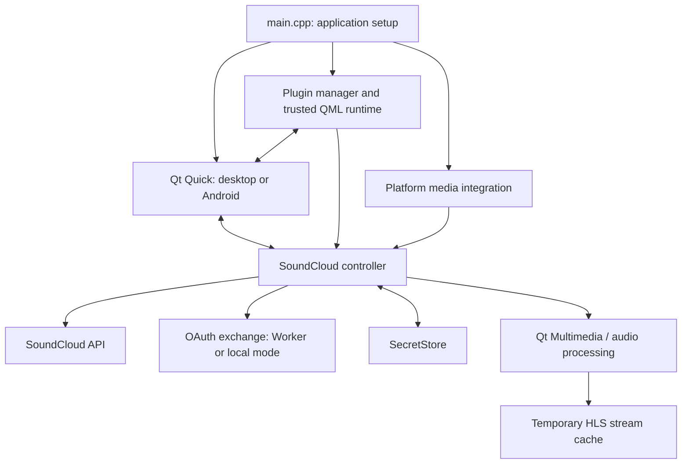

[Home](Home) › Architecture

Sange is a C++20 application with Qt Quick interfaces and CMake builds. Desktop and Android share the SoundCloud controller, playback logic and plugin engine, with separate top-level QML layouts and native media integrations.

## Runtime flow

The diagram groups responsibilities; these are in-process components, except the remote services and operating-system facilities.

## Source map

| Location | Responsibility |
| --- | --- |
| `src/main.cpp` | App/storage identity, single instance on desktop, QML context, service wiring and tray |
| `qml/Main.qml` | Desktop interface |
| `qml/android/Main.qml` | Android interface |
| `qml/*.qml` | Shared controls for collections, selection, plugins, playback and comments |
| `src/soundcloud.*` | OAuth, API coordination, catalogue/account state and playback controller |
| `src/soundcloudsocial.cpp` | Social operations, collections and playlist workflows |
| `src/recommendationpreferences.cpp` | Account-scoped recommendation preferences and exclusions |
| `src/secretstore.*` | OS-protected credential storage |
| `src/streamcache.*` | Local HLS proxy, temporary segment cache and speculative loading |
| `src/audioeffects.*` | PCM processing and spectrum analysis |
| `src/trackwaveform.*` | Track waveform support |
| `src/lyrics.*` | Independent lyrics transport, parsing and custom text |
| `src/artworknetwork.*` | QML artwork transport |
| `src/pluginmanifest.*`, `src/plugins.*` | Manifest validation, registry, declarative permissions/events/commands |
| `src/pluginruntime.*` | Trusted QML runtime and SDK lifecycle |
| `src/desktopmedia.*`, `src/mpris.cpp`, `src/smtc.cpp` | Desktop media controls |
| `src/androidmedia.*`, `packaging/android/src/` | Android media bridge, service and platform helpers |
| `src/linkrouter.*` | Desktop URL routing |
| `src/discordpresence.*` | Optional local Discord RPC |
| `src/diagnostics.*` | Local filtered diagnostics in current source |
| `worker/` | Public OAuth exchange service |
| `tests/`, `.github/workflows/` | Regression fixtures and CI |
| `packaging/`, `scripts/` | Platform deployment and build helpers |

Browse the [source tree](https://github.com/sykia/sange). Paths describe current source; they do not imply every published binary contains the newest implementation.

## QML boundary

`main.cpp` constructs the shared services and exposes context objects such as `sc`, `pluginManager`, `lyricsBackend`, `discordPresence` and the Android bridge. QML invokes controller operations and reacts to state/signals. CMake selects the top-level interface; `SCRIP_MOBILE_PREVIEW` selects the Android layout on desktop.

The QML module retains the `SCrip` URI. Organization/application storage identities remain `Qsae` / `SCrip`, preserving upgrade compatibility while the display name is Sange.

## Network and account state

Authenticated API traffic is limited to the expected HTTPS API host; pagination and redirects are validated. Token refresh is serialized. Account/request generations prevent stale responses from replacing newer state. The request coordinator shares eligible reads and handles bounded retries and quota responses.

The public Worker handles token exchange, not music proxying. Local mode calls SoundCloud's token endpoint directly. Secure-store writes must succeed before a refreshed session is used. Artwork and lyrics transports do not receive SoundCloud OAuth authorization headers.

## Playback and platform integration

The controller owns queue/history, wave refills, playback intent and stream selection. Qt Multimedia decodes audio; `StreamCache` provides a temporary local HLS proxy. Preloading can prepare upcoming playback and warm segments. Desktop crossfade uses two players; Android disables crossfade.

Linux uses MPRIS on the session D-Bus, Windows uses SMTC and Android uses its native media bridge/service. Commands route through the controller rather than separate playback state machines. Discord uses local asynchronous IPC and is independent of audio playback.

## Plugin boundary

Declarative packages receive validated contributions, approved commands and bounded event/data handling. `plugins.json` stores copied manifests and state using atomic saves and conflict protection.

QML packages use the application's QML engine and receive the real exposed host objects through their SDK. Their `code.execute` permission is an explicit trust boundary, not isolation. See [Plugin System](Plugin-System).

## Persistence

| Data | Mechanism |
| --- | --- |
| OAuth/session secrets | Platform `SecretStore` |
| Preferences, saved searches and account-scoped exclusions | Platform QSettings |
| Installed plugins and own plugin data | `plugins.json` in app data |
| HLS segments | Bounded temporary cache |
| Provider lyrics cache | Memory; custom lyrics use QSettings |
| Current-source diagnostics | Rotating local files under app data `logs/` |

Keep personal data, credentials and local toolchains out of tracked source. Generated build and fixture output belongs in `build/`.

## Validation

See [Building from Source](Building-from-Source#validation-boundaries). Mocked transport and offscreen QML fixtures cover shared behavior, while native services, actual devices and live playback need their corresponding integration checks. A desktop build is not proof of Android or Windows deployment behavior.

---
[Building from Source](Building-from-Source) · [Home](Home)
